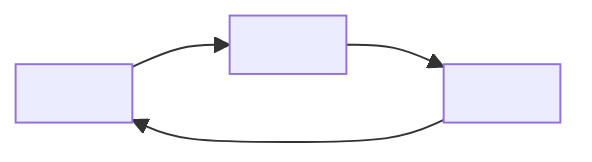

# <Game name>: game design plan

<!-- Template for references/game-design.md. Replace every <...> and every comment. Sections marked "redesign" are for a
game that already exists; delete them for a new one. Keep the numbering and add rows freely. -->

Status: draft | in review | approved. Updated <YYYY-MM-DD>. Numbers marked *(start)* are starting values to tune in play tests.

## Contents

<!-- Numbered links to every section below. -->

---

## 1. Summary

> **<The pitch: one sentence a player would repeat to a friend; the thumbnail line.>**

| | |
|---|---|
| Fantasy | You are a <role> who <verb> to become <who you grow into>. |
| Direction | <one word>, expanding by <what "more" means> |
| Pillars | 1. <...> 2. <...> 3. <...> |
| Hook | <what this game has that comparable games don't> |
| Kinds of fun | <2-3 of sensation, fantasy, narrative, challenge, fellowship, discovery, expression, submission> |
| Audience | <ages and tastes>; phone first, then <tablet, desktop, console> |
| Comparable games | <game>: take <...>, avoid <...> |
| Play pattern | <minutes> a day over <n> sessions; endgame for engaged free players by week <n> |

## 2. Today (redesign)

### What works (keep it)
### What is thin

| Problem | Today |
|---|---|

### Already in the data (free to use)
### Measured pacing today

<!-- From the current configs through PacingSim, not from memory. -->

## 3. The fantasy

- **Who you are, what you do, who you become:** <start> → <mid game> → <endgame>.
- **The thumbnail moment:** <the image that sells the game>.
- **What the game owns:** <mascot, mechanic or world nobody else has>.

| System | Fantasy beat | What other players see |
|---|---|---|

## 4. How the game is played

### Controls

| Action | Phone | Gamepad | Keyboard and mouse |
|---|---|---|---|

### The first ten minutes

| Time | The player does | The game shows | Teaches or rewards |
|---|---|---|---|
| 0:00 | | | |

### A day-2 session

<!-- 5-8 sentences: why they came back, what they do, what they leave in progress. -->

### A week-3 session

<!-- What a veteran does; which depth layers they use now. -->

## 5. Loops



| Loop | Time | Actions | Reward | Feeds |
|---|---|---|---|---|
| Moment | | | | |
| Core | | | | |
| Session | | | | |
| Meta | | | | |
| Social | | | | |
| Live | | | | |

## 6. Systems

<!-- One subsection per system: what it is, how it plays, its numbers, the pillar, loop and track it serves, what it
consumes and produces. -->

### System: <name>

## 7. Progression

### Tracks

| Track | Kind | Cadence | Shown where | Milestones |
|---|---|---|---|---|

### Unlock schedule

| When (active play) | Unlocks | Why now |
|---|---|---|

### Pacing

<!-- PacingSim report for the casual (cheapest) and optimizer (value) players; model at tools/pacing/model.luau. -->

| Milestone | Target | Casual player | Optimizer | Verdict |
|---|---|---|---|---|

### Prestige
### Endgame
### Catch-up

## 8. Depth

### Layers

| Layer | Opens at | New kind of decision | Mastery looks like |
|---|---|---|---|

### Decisions

| Decision | Options | When each is right |
|---|---|---|

### Skill

<!-- The factor by which active play beats idle, where skill shows, its ceiling. -->

### Discovery

<!-- Secrets, combos and knowledge players will share. -->

### How systems interact

<!-- A produces X, which B consumes. -->

## 9. Engagement and retention

### First-session beats
### Session hooks
### Return hooks
### Social hooks
### Live calendar (first 8 weeks)

| Week | Update or event | New content | New twist |
|---|---|---|---|

## 10. Economy

### Currencies

| Currency | Sources | Sinks | Shown where | Why it exists |
|---|---|---|---|---|

### Faucets and sinks by phase

| Phase | Sources (per min) | Sinks (per min) | Net |
|---|---|---|---|

### Curves and formulas
### Odds

<!-- PacingSim rngTable: tier, odds, chance with luck, median and p90 time, pity. -->

### Number range
### Simulation

<!-- Model assumptions (session length, sessions a day, offline rule, policies), the run command, the date, and the
income curve (PacingSim curve). -->

## 11. Monetization

| Offer | Type | Price (R$) | Fantasy it amplifies | Free path | Fairness note |
|---|---|---|---|---|---|

### When offers appear
### Compliance

<!-- Every paid random item and where its odds are shown; the PolicyService treatment; trading rules; receipts. -->

## 12. Social and multiplayer

<!-- Server size, interaction types, trading, protection from griefing, chat-free social tools, text filtering. -->

## 13. UX and platform

### Phone HUD

```text
<ASCII sketch at 844 x 390: thumb zones, the core action, the three goals in view>
```

### Readability

<!-- Rarity colors and second cues, number format, how little text there is. -->

### Performance budget

<!-- Moving units on screen, effects, parts per plot, on a low-end phone. -->

## 14. What changes (redesign)

| Today | Becomes |
|---|---|

### Existing players

<!-- What current saves get, the migration, any compensation. -->

## 15. Production

### Systems and data

| System | Server | Client | Config and data | Save fields |
|---|---|---|---|---|

### Launch content

| Content | At launch | Cost per unit | Pipeline |
|---|---|---|---|

### Vertical slice

<!-- The smallest build that proves the core verb, the first ten minutes and one meta hook. -->

### Build order

| Step | Ships | Size | Measure | Go on when |
|---|---|---|---|---|

### Roadmap

| Update | Headline | Content | New twist | Direction it extends |
|---|---|---|---|---|

## 16. Metrics

| KPI | Target | Source |
|---|---|---|
| First-play bounce | | Creator Dashboard |
| D1 / D7 / D30 return | | Creator Dashboard |
| Play days per user (D2-7, D8-28) | | Creator Dashboard |
| Playtime per user (minutes a day) | | Creator Dashboard |
| Co-play share | | Creator Dashboard |
| Payer conversion; spend days per user | | Creator Dashboard |
| Onboarding completion | | onboarding funnel |

### Funnels and events

<!-- The onboarding funnel, then one funnel per progression feature, each starting at tutorial completion
(references/onboarding.md). Kind: lifetime or per attempt. Failures and friction are custom events, not steps. -->

| Funnel | Feature | Kind | Steps, in order | Custom fields |
|---|---|---|---|---|
| Onboarding | Tutorial | Lifetime | One per lesson | |

### Experiments
### Pivot criteria

## 17. Risks, assumptions and open questions

## 18. Review

| Check | Score (0-2) | Why |
|---|---|---|
| Fantasy | | |
| Direction | | |
| First minutes | | |
| Simple | | |
| Depth | | |
| Progression | | |
| Goals | | |
| Engagement | | |
| Social | | |
| Economy | | |
| Monetization | | |
| Platform | | |
| Live ops | | |
| Feasibility | | |

## Changelog

- <YYYY-MM-DD>: <change>
